# KevinCrrl

## Personal Website (Mainly Spanish, some translations available in English)

[https://KevinCrrl.github.io/KevinCrrl/](https://KevinCrrl.github.io/KevinCrrl/)

---

## Recent Activity

<!--START_SECTION:activity-->

1. 💪 Opened PR [#5151](https://github.com/BlackArch/blackarch/pull/5151) in [BlackArch/blackarch](https://github.com/BlackArch/blackarch)
2. ℹ️ Labeled issue [#12](https://github.com/KevinCrrl/evillimiter-ng/issues/12) in [KevinCrrl/evillimiter-ng](https://github.com/KevinCrrl/evillimiter-ng)
3. ℹ️ Labeled issue [#12](https://github.com/KevinCrrl/evillimiter-ng/issues/12) in [KevinCrrl/evillimiter-ng](https://github.com/KevinCrrl/evillimiter-ng)
4. ℹ️ Labeled issue [#12](https://github.com/KevinCrrl/evillimiter-ng/issues/12) in [KevinCrrl/evillimiter-ng](https://github.com/KevinCrrl/evillimiter-ng)
5. ❗ Opened issue [#12](https://github.com/KevinCrrl/evillimiter-ng/issues/12) in [KevinCrrl/evillimiter-ng](https://github.com/KevinCrrl/evillimiter-ng)

<!--END_SECTION:activity-->

## Activity by day

# License

- My website includes a copy of [highlight.js](https://github.com/highlightjs/highlight.js), which is licensed under the BSD-3-Clause License. You can find a copy of its license in [this directory](static/js/highlight/LICENSE).

- All other scripts (`*.js`, `*.py`) in this repository written by me are licensed under the Apache-2.0 License.
